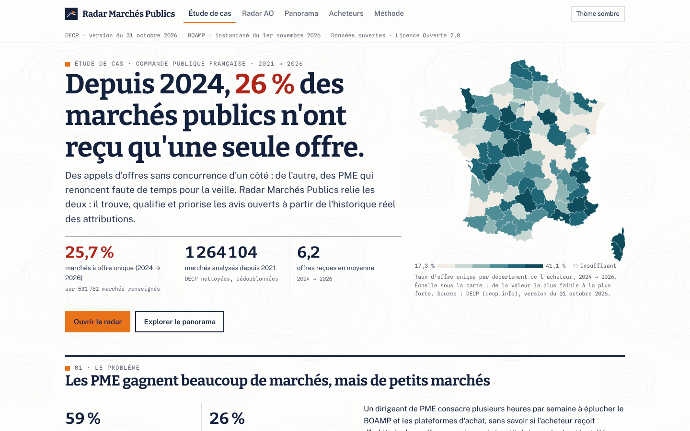
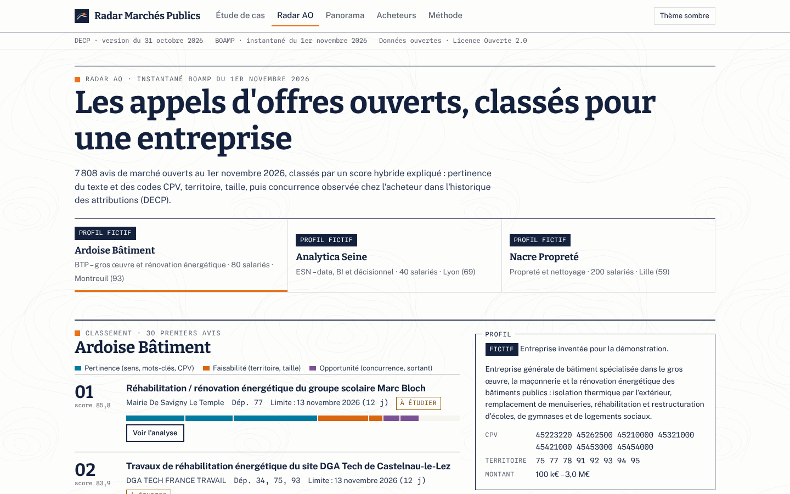
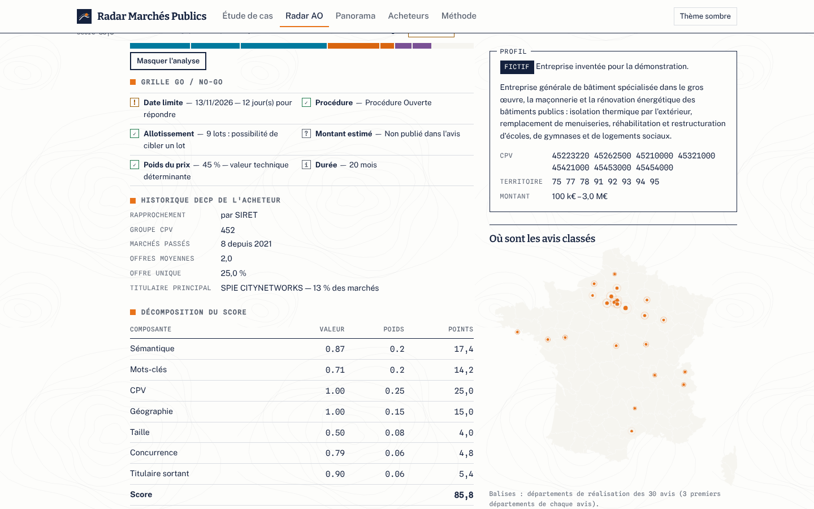
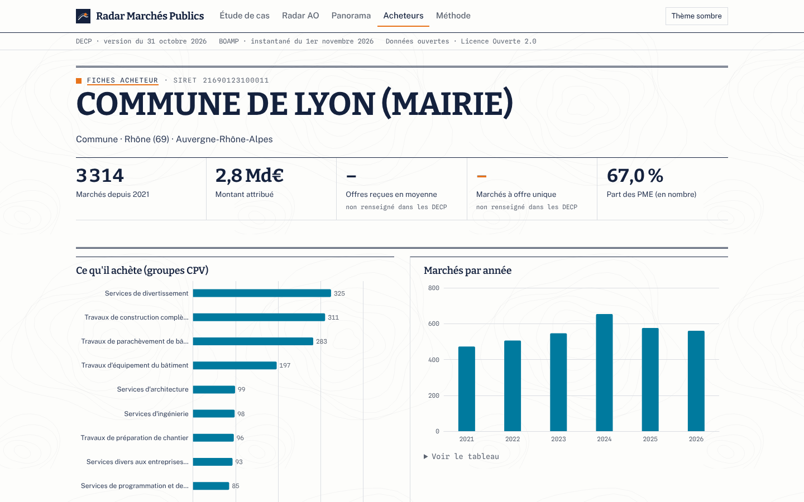
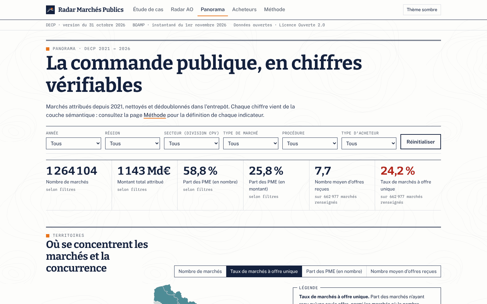
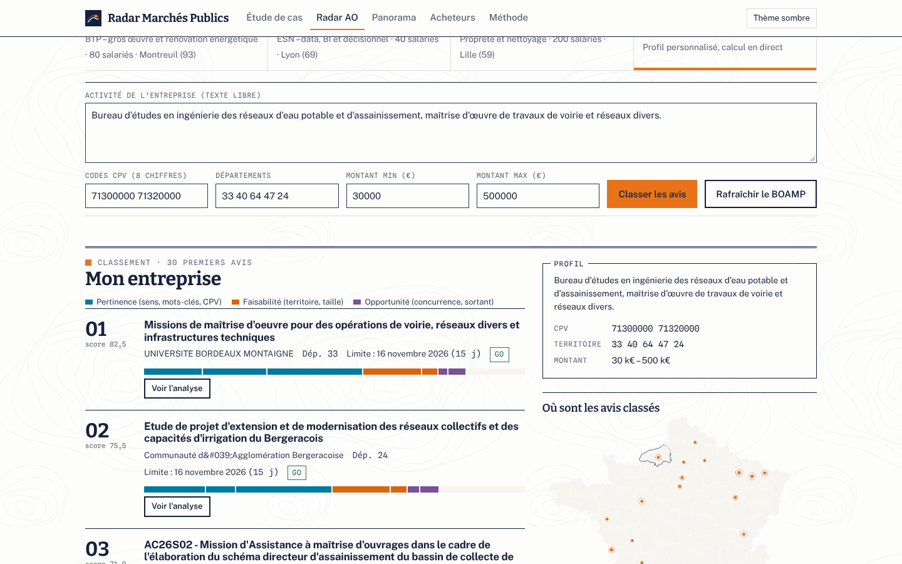
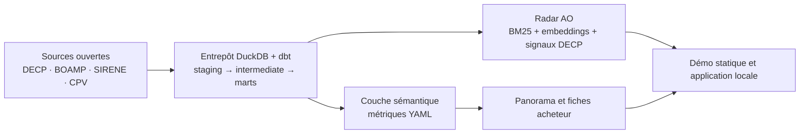

# Radar Marchés Publics

> Un radar d'appels d'offres pour les PME : il trouve, qualifie et priorise les avis de marchés publics ouverts à partir de l'historique réel des attributions, afin de répondre moins souvent au hasard et plus souvent là où l'on peut gagner.

**[Voir la démo](https://youssefmir.github.io/radar-marches-publics/)** · [Démarche BA](docs/README.md) · [Résultats clés](#resultats)



*La page d'ouverture : le constat chiffré, issu des données réelles, et la carte de l'offre unique par département.*

## En bref

| Question | Réponse |
|---|---|
| **Le problème** | Les PME manquent de temps pour la veille et ne voient pas la concurrence : plusieurs milliers d'avis ouverts, sans historique de l'acheteur. |
| **La solution** | Un entrepôt de 1 264 104 marchés attribués (DECP) et un moteur de classement hybride et expliqué des 7 808 avis ouverts du BOAMP. |
| **Les résultats** | 25,7 % des marchés n'ont reçu qu'une offre depuis 2024 ; les PME gagnent 59 % des marchés mais 26 % du montant ; l'hybride atteint un nDCG@10 de 0,427 sur des avis jamais vus. |
| **Pour qui** | Dirigeants de PME et chargés d'affaires qui répondent ou veulent répondre aux marchés publics. |

## Sommaire

- [Essayer en 1 minute](#essayer-en-1-minute)
- [Ce que vous pouvez faire](#ce-que-vous-pouvez-faire)
- [Résultats](#resultats)
- [Comment ça marche](#comment-ça-marche)
- [La démarche Business Analyst](#la-démarche-business-analyst)
- [Référence des commandes](#référence-des-commandes)
- [Qualité, données et limites](#qualité-données-et-limites)
- [FAQ](#faq)
- [Auteur et licence](#auteur-et-licence)

## Essayer en 1 minute

**1. En ligne, sans rien installer** : ouvrez la [démo](https://youssefmir.github.io/radar-marches-publics/). Elle contient le panorama, 1 000 fiches acheteur et le radar précalculé pour trois entreprises fictives.

**2. En local, avec votre propre profil d'entreprise.** Prérequis : Python 3.12 ou plus, [uv](https://docs.astral.sh/uv/), Node.js 20 ou plus, GNU Make, environ 2 Go d'espace disque.

```bash
git clone https://github.com/youssefmir/radar-marches-publics.git && cd radar-marches-publics
make install
make app
```

Ouvrez ensuite <http://127.0.0.1:8000/radar-marches-publics/#/radar> et choisissez « Mon entreprise ». L'application utilise l'instantané BOAMP et l'historique versionnés dans le dépôt. Le premier classement télécharge le modèle d'embeddings (environ 120 Mo) et calcule l'index des avis : comptez environ 4 minutes sur un processeur standard, une seule fois.

## Ce que vous pouvez faire

### Trouver les appels d'offres faits pour votre entreprise

Décrivez votre activité, vos codes CPV (la nomenclature européenne des achats publics), vos départements et votre fourchette de montant. Le radar classe les avis ouverts et explique chaque score en sept composantes.



*Le radar pour « Ardoise Bâtiment », PME fictive du BTP en Île-de-France.*

### Décider en une minute : go ou no-go

Chaque avis affiche une grille issue de ses champs structurés (date limite, procédure, lots, montant, poids du prix) et l'historique de l'acheteur dans les DECP : nombre d'offres reçues d'habitude, taux d'offre unique, titulaire principal.



*L'analyse d'un avis : chaque point du score est justifié.*

### Connaître l'acheteur avant de répondre

Les fiches des 1 000 acheteurs les plus actifs montrent ce qu'ils achètent, à quel montant, avec quelle concurrence, et qui gagne.



*Une fiche acheteur. Les noms des titulaires ne sont affichés que pour les personnes morales.*

### Choisir ses terrains de jeu

Le panorama filtre la commande publique par année, région, secteur, type de marché, procédure et type d'acheteur : volumes, montants, part des PME et intensité concurrentielle.



*Le panorama ; tous les chiffres viennent de la même couche sémantique.*

### Utiliser votre propre profil et des avis frais

L'application locale ajoute un formulaire de profil, le rafraîchissement du BOAMP en direct et, si vous fournissez une clé, un résumé d'avis par LLM.



*L'application locale : un bureau d'études fictif saisi dans le formulaire.*

<a id="resultats"></a>
## Résultats

**Ce que révèlent les données** (DECP, 1 264 104 marchés notifiés du 1er janvier 2021 au 31 octobre 2026) :

| Indicateur | Valeur | Lecture |
|---|---:|---|
| Marchés à offre unique, 2024 → 2026 | 25,7 % | Au-dessus du seuil de 20 % jugé insatisfaisant par le tableau de bord du marché unique de la Commission européenne |
| Offres reçues en moyenne, 2024 → 2026 | 6,2 | Des écarts forts selon le secteur et l'acheteur |
| Part des PME en nombre de marchés | 59 % | Les PME gagnent beaucoup de marchés… |
| Part des PME en montant | 26 % | … mais surtout les petits |
| Montant médian d'un marché | 105 k€ | Un marché typique reste accessible à une PME |

**Ce que mesure l'évaluation du radar** (5 089 avis de test jamais utilisés pour le réglage ; vérité terrain : leurs codes CPV) :

| Requêtes | BM25 | Embeddings e5-small | Hybride réglé |
|---|---:|---:|---:|
| Q1 « profil CPV » (223 requêtes), nDCG@10 | 0,323 | 0,184 | **0,338** |
| Q2 « avis exemple » (295 requêtes), nDCG@10 | 0,404 | 0,358 | **0,427** |
| Q2, précision@10 | 0,382 | 0,330 | **0,404** |

- L'hybride est le meilleur des trois, mais son avance sur BM25 est modeste (intervalles de confiance qui se recouvrent).
- Les embeddings seuls restent en retrait : le vocabulaire des marchés est technique et le mot exact compte.
- Les scores sont une borne basse : une partie des « erreurs » sont des avis utiles codés dans une classe CPV voisine.

**Ce que cela implique pour une PME** : ne pas se fier au seul mot-clé ni au seul code CPV, cibler les acheteurs où la concurrence est faible, et vérifier le titulaire sortant avant d'investir dans un dossier. Détails : [évaluation](docs/evaluation-radar.md), [qualité des données](docs/qualite-donnees.md).

## Comment ça marche



- **Données** : les DECP consolidées par decp.info sont nettoyées dans un entrepôt DuckDB par dbt (modèle en étoile, 72 tests, règles de dédoublonnage chiffrées).
- **Indicateurs** : une couche sémantique en YAML définit chaque métrique une seule fois ; le site et le README en dérivent.
- **Radar** : un score hybride combine sens (embeddings multilingues), mots-clés (BM25), codes CPV, territoire, taille, concurrence historique et titulaire sortant.
- **Site** : React et ECharts, sans aucun CDN ; le panorama agrège un cube Parquet directement dans le navigateur.

Architecture détaillée : [docs/architecture.md](docs/architecture.md). Documentation dbt en ligne (modèles, tests, lignage) : [dbt-docs](https://youssefmir.github.io/radar-marches-publics/dbt-docs/).

## La démarche Business Analyst

| Livrable | Ce qu'il apporte | Lien |
|---|---|---|
| Note de cadrage | Problème, objectifs, périmètre | [Lire](docs/ba/01-note-de-cadrage.md) |
| Personas et parcours | Pour qui, et les moments de vérité | [Lire](docs/ba/02-personas-parcours.md) |
| BPMN AS-IS / TO-BE | Ce qui change dans la veille | [Lire](docs/ba/03-processus-bpmn.md) |
| User stories et MVP | INVEST, Gherkin, MoSCoW | [Lire](docs/ba/04-user-stories.md) |
| KPI et business case | Arbre de KPI, hypothèses explicites, sensibilité | [Lire](docs/ba/05-kpi-business-case.md) |
| Risques et conformité | RGPD, AI Act, registre des risques | [Lire](docs/ba/06-risques-conformite.md) |
| Plan de recette | Stratégie de tests, cas de recette | [Lire](docs/ba/07-plan-de-recette.md) |
| Journal des décisions | 13 choix défendables : contexte, options, choix, raisons | [Lire](docs/decisions.md) |

## Référence des commandes

| Commande | Effet |
|---|---|
| `make install` | Crée l'environnement Python et installe les dépendances du site |
| `make app` | Construit le site et lance l'application locale |
| `make data` | Télécharge les sources (DECP figée par empreinte, 255 Mo) |
| `make pipeline` | Construit l'entrepôt, lance les tests dbt, régénère qualité, historique et exports |
| `make evaluate` | Rejoue l'évaluation du radar (environ 10 minutes sur CPU) |
| `make boamp` | Prend un nouvel instantané des avis ouverts |
| `make test` | Lint, tests Python (pytest) et tests du front (Vitest) |
| `make dbt-docs` | Génère la documentation dbt, publiée avec le site |
| `make screenshots` | Régénère les captures de `docs/img/` |
| `make all` | Toute la chaîne, des sources aux captures |

`make help` liste toutes les commandes.

## Qualité, données et limites

**Tests** : 72 tests dbt (unicité, intégrité référentielle, valeurs acceptées, conservation des montants), 32 tests pytest, 11 tests Vitest, captures Playwright sans erreur console. Les liens de la documentation sont vérifiés par `scripts/check_links.py`.

**Sources et licences**

| Source | Usage | Licence |
|---|---|---|
| [DECP consolidées (decp.info)](https://www.data.gouv.fr/datasets/donnees-essentielles-de-la-commande-publique-consolidees-format-tabulaire) | Marchés attribués, version du 31 octobre 2026 | Licence Ouverte 2.0 |
| [BOAMP (DILA)](https://boamp-datadila.opendatasoft.com/explore/dataset/boamp/) | Avis ouverts, instantané du 1er novembre 2026 | Licence Ouverte 2.0 |
| [API Recherche d'entreprises](https://recherche-entreprises.api.gouv.fr) | Catégorie et forme juridique de 3 000 titulaires | Licence Ouverte 2.0 |
| [Nomenclature CPV 2008](https://public.opendatasoft.com/explore/dataset/nomenclature-cpv/) | Libellés français des codes | CC BY 4.0 |
| [geo.api.gouv.fr](https://geo.api.gouv.fr) et [france-geojson](https://github.com/gregoiredavid/france-geojson) | Départements, régions, contours (IGN Admin Express) | Licence Ouverte 2.0 |
| [multilingual-e5-small](https://huggingface.co/intfloat/multilingual-e5-small) | Embeddings | MIT |

**Données versionnées** : les fichiers bruts (255 Mo pour la DECP) ne sont pas dans le dépôt, mais leurs URL et empreintes SHA-256 sont figées dans [`data/sources.lock.json`](data/sources.lock.json). Le dépôt contient les données compactes réelles : référentiels, instantané BOAMP aplati, historique de concurrence, exports du site.

**Limites**

- Les montants des DECP sont déclaratifs ; pour un accord-cadre, c'est un plafond, pas une dépense.
- Le nombre d'offres n'est massivement renseigné que depuis 2024 : les tendances antérieures sont fragiles.
- La démo repose sur l'instantané BOAMP du 1er novembre 2026 ; les dates limites passées n'y sont pas retirées.
- La carte couvre la métropole ; les outre-mer figurent dans les tableaux.
- Le résumé par LLM n'a pas pu être testé avec un vrai fournisseur faute de clé ; sans clé, il est désactivé et rien n'est simulé.
- Le score aide à trier ; la décision reste humaine, avis officiel à l'appui.

## FAQ

**Les entreprises de la démo existent-elles ?** Non. Ardoise Bâtiment, Analytica Seine et Nacre Propreté sont fictives et signalées comme telles ; les avis et l'historique sont réels.

**Faut-il une clé d'API ?** Non. Seul le résumé optionnel d'avis demande une clé Mistral ou compatible OpenAI (`RADAR_LLM_API_KEY`).

**À quelle fréquence les données sont-elles mises à jour ?** La démo est figée à la date de l'instantané. En local, `make boamp` ou le bouton « Rafraîchir le BOAMP » récupère les avis du jour.

**Pourquoi certains titulaires sont-ils masqués ?** Un entrepreneur individuel est une personne physique : par précaution (RGPD), un nom n'est affiché que si le titulaire est une personne morale avérée.

**Comment le score est-il calculé ?** Somme pondérée de sept composantes, toutes affichées : voir le [journal des décisions](docs/decisions.md) (D8 à D10) et la [configuration des poids](config/profils.yml).

## Auteur et licence

Projet réalisé par **Youssef Mir**, Business Analyst IA (Master MIAGE Informatique décisionnelle, Université Paris-Saclay) · [github.com/youssefmir](https://github.com/youssefmir)

Code sous licence [MIT](LICENSE). Données : crédits et licences des producteurs listés ci-dessus (DILA, decp.info, INSEE, IGN, Communautés européennes).
