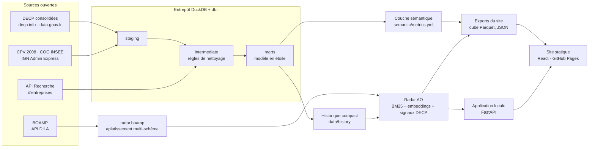
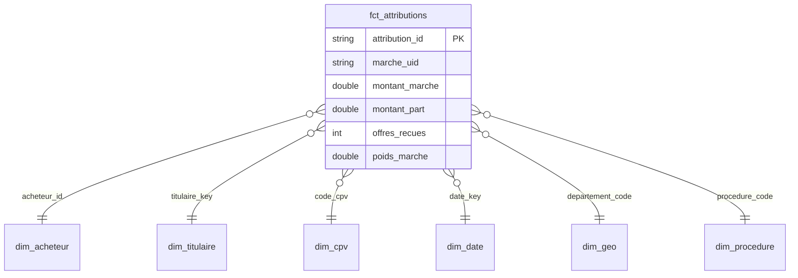
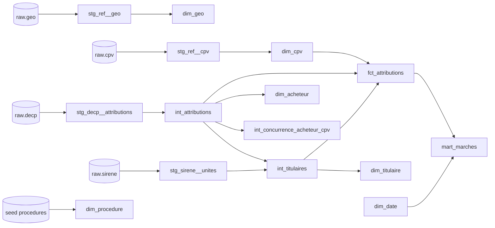

# Architecture

## Flux de données

## Modèle en étoile

Grain : une attribution initiale = un marché × un titulaire. `montant_part` répartit le montant entre co-titulaires ; `poids_marche` (1 / nombre de titulaires) permet de compter les marchés de façon additive.

## Lignage dbt

La documentation dbt complète (descriptions, tests, lignage interactif) se génère avec `make dbt-docs` puis `cd dbt && ../.venv/bin/dbt docs serve --profiles-dir .`.

## Organisation du dépôt

| Dossier | Contenu |
|---|---|
| `pipeline/radar/` | Téléchargement, parseur BOAMP, SIRENE, couche sémantique, scoring, évaluation, exports, API |
| `dbt/` | Projet dbt (staging, intermediate, marts, tests, seeds) |
| `semantic/` | Définitions des indicateurs |
| `config/` | Profils fictifs et poids du score |
| `data/` | Données compactes versionnées : référentiels, instantané BOAMP, historique, empreintes des sources |
| `web/` | Site React (Vite, TypeScript, ECharts, motion) |
| `tests/` | Tests pytest |
| `docs/` | Démarche BA, rapports générés, captures |
