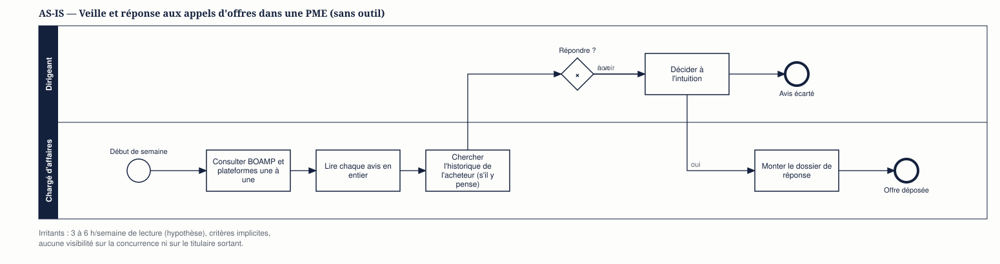
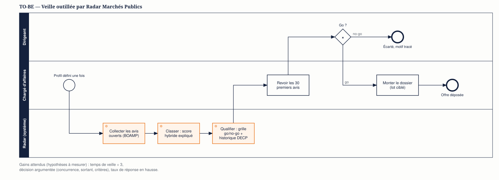

# Processus de veille et de réponse : AS-IS / TO-BE

Les diagrammes suivent la norme BPMN 2.0. Les fichiers `.bpmn` s'ouvrent dans bpmn.io ou Camunda Modeler. Ils sont générés, avec leur rendu SVG, par [`bpmn/generer.py`](bpmn/generer.py).

## AS-IS — veille manuelle

*Fichier source : [as-is.bpmn](bpmn/as-is.bpmn)*

**Irritants identifiés**

| Irritant | Conséquence |
|---|---|
| Consultation source par source | 3 à 6 h par semaine (hypothèse), avis manqués |
| Lecture intégrale de chaque avis | Saturation, tri tardif |
| Historique de l'acheteur rarement consulté | Réponses à des marchés verrouillés par un titulaire sortant |
| Décision à l'intuition | Taux de succès faible et non expliqué |

## TO-BE — veille outillée

*Fichier source : [to-be.bpmn](bpmn/to-be.bpmn)*

**Changements clés**

1. Les tâches répétitives (collecte, tri, recherche d'historique) passent au système.
2. L'humain intervient sur une liste courte, avec les éléments de décision réunis.
3. La décision reste humaine ; le motif d'un « no-go » est tracé (piste d'évolution du MVP).
