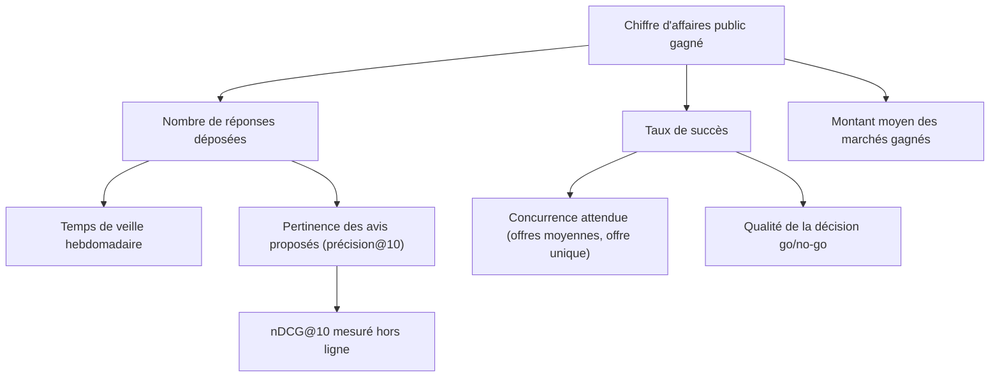

# Arbre de KPI et business case

## Arbre de KPI

| Niveau | KPI | Définition | Source | Valeur actuelle |
|---|---|---|---|---|
| Nord | CA public gagné | Somme des marchés gagnés | CRM de l'entreprise | à mesurer en pilote |
| Résultat | Réponses déposées | Nombre par an | Entreprise | hypothèse : 12 |
| Résultat | Taux de succès | Gagnées / déposées | Entreprise | hypothèse : 20 % |
| Levier | Temps de veille | Heures par semaine | Déclaratif | hypothèse : 4 h |
| Levier | Pertinence | Précision@10 | [Évaluation](../evaluation-radar.md) | mesurée |
| Contexte | Offre unique | Taux de marchés à offre unique | [Panorama](https://youssefmir.github.io/radar-marches-publics/#/panorama) | mesuré |

## Business case (par PME utilisatrice, sur un an)

Toutes les valeurs ci-dessous sont des **hypothèses** de travail, à confirmer en pilote. Le calcul est volontairement simple et traçable.

| Hypothèse | Valeur | Justification |
|---|---|---|
| Temps de veille actuel | 4 h/semaine | Hypothèse de travail, non sourcée : première mesure à faire en pilote |
| Semaines travaillées | 45 | Hors congés |
| Coût horaire chargé du dirigeant | 55 € | Hypothèse prudente |
| Gain de temps | 60 % | Tri et qualification automatisés ; lecture limitée à une liste courte |
| Réponses par an : avant → après | 12 → 18 | Temps libéré réinvesti dans les dossiers |
| Taux de succès | 20 % | Hypothèse, stable |
| Montant moyen d'un marché gagné | 150 000 € | Hypothèse ; au-dessus de la médiane mesurée des DECP (environ 105 k€) car un marché moyen est tiré vers le haut par les gros lots |
| Marge nette sur un marché | 8 % | Hypothèse BTP / services |
| Coût annuel de l'outil | 3 000 € | Hypothèse (abonnement, maintenance) |

**Calcul**

- Temps économisé : 4 h × 45 × 60 % = **108 h/an**, soit 108 × 55 € = **5 940 €**.
- Marge additionnelle : (18 − 12) réponses × 20 % × 150 000 € × 8 % = **14 400 €**.
- Bénéfice annuel brut : 5 940 + 14 400 = **20 340 €**, pour un coût de 3 000 €.

**Sensibilité** (bénéfice brut annuel, en €, selon le taux de succès et la marge)

| Taux de succès \ Marge | 5 % | 8 % | 10 % |
|---|---:|---:|---:|
| 15 % | 12 690 | 16 740 | 19 440 |
| 20 % | 14 940 | 20 340 | 23 940 |
| 25 % | 17 190 | 23 940 | 28 440 |

Même dans le scénario le plus défavorable du tableau, le bénéfice dépasse le coût supposé. Le principal risque porte sur l'hypothèse « + 6 réponses par an » : le pilote doit la mesurer en priorité.

## Plan de mesure (pilote de 3 mois)

1. Relever le temps de veille déclaré avant le pilote, puis chaque mois.
2. Journaliser les avis consultés, retenus (go) et écartés (motif).
3. Comparer le nombre de réponses et le taux de succès aux 12 mois précédents.
